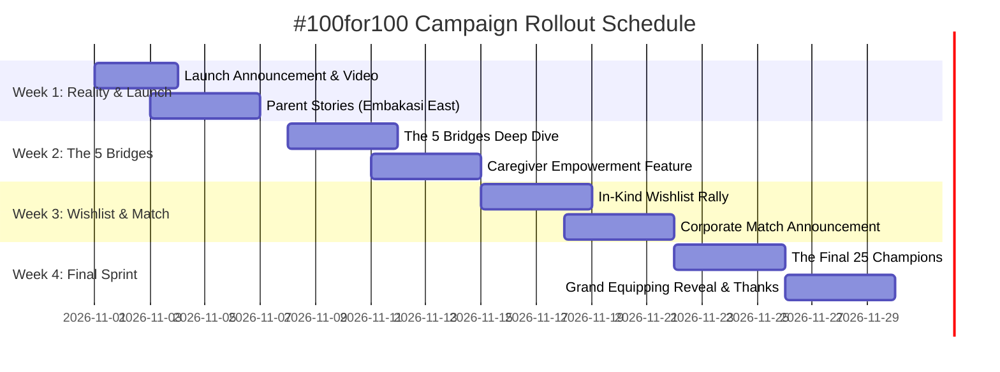

# MindBridge Therapy & Rehabilitation Centre
## #100for100 Campaign: Partner Share Kit & 4-Week Content Calendar

> **Host Organization**: Stand Out 4 Mental Health (SO4MH)  
> **Campaign Title**: #100for100 — 100 Champions Standing for 100 Children  
> **Primary Goal**: Equipping Phase (KES 500,000 Target)  
> **Target Population**: 100 Children with Neurodevelopmental Disabilities & Caregiver Units (Embakasi East / Mukuru Settlements, Nairobi)  
> **Campaign Links**: [Stand Out 4 Mental Health](https://standout4mentalhealth.org) &bull; [Run For Mental Health Africa](https://runformentalhealthafrica.org)  

---

## 1. Executive Toolkit Overview

This kit empowers board members, champions, allied pediatric therapists, running clubs, and corporate partners to communicate about MindBridge with unified voice, high visual appeal, and maximum conversion.

### The Core Giving Formula
$$\mathbf{100\ Champions} \times \mathbf{KES\ 5,000} = \mathbf{KES\ 500,000\ (Equipped\ Centre)}$$

* **Primary Supporter Route**: Become 1 of 100 Champions (Gift KES 5,000 or custom amount).
* **In-Kind Equipment Route**: Pledge physical therapy mats, sensory swings, or positioning aids from our verified registry.
* **Professional Ally Route**: Pediatric Occupational Therapists (OTs), Speech & Language Therapists (SLTs), and physiotherapists committing clinical volunteering hours.

---

## 2. The Voice Behind the Mission

> *"In many under-resourced communities in Kenya, having a child with a neurodevelopmental disability can mean spending your days searching for support that is simply too far away or too expensive to reach.*
> 
> *I have seen how families struggle with the cost of therapy, transport, limited specialised services and the lack of appropriate spaces where children can receive consistent support. For some caregivers, accessing therapy can mean missing work, spending money they do not have, or travelling long distances just to get their child the help they need.*
> 
> *And when that support is delayed, it is not only the child who is affected. The caregiver carries the burden too. They are often expected to figure out communication, behaviour, play, daily routines and development on their own, without the practical support they need.*
> 
> *Behind every statistic is a child who wants to participate, communicate, play and learn, and a caregiver who simply wants to know, 'How can I help my child?'*
> 
> *The problem is not that these children cannot thrive. The problem is that the support they need is often not close enough, affordable enough or accessible enough.*
> 
> *That is the gap MindBridge is being built to address. We are mobilizing #100for100, 100 supporters to support 100 children and their caregivers. Will you be counted among the 100?"*

---

## 3. Official Payment & Donation Instructions

Supporters can give directly through verified SO4MH accounts:

| Channel | Method Details | Instructions / Notes |
| :--- | :--- | :--- |
| **M-PESA Paybill (Kenya)** | **Business No:** `891300`<br>**Account:** `148469`<br>**Name:** Stand Out 4 Mental Health | Instant Safaricom prompt; confirmation SMS serves as immediate receipt. |
| **Physical Equipment Drop & In-Kind** | Embakasi East Centre & Nairobi Hub | Coordinate therapy mats, sensory toys, and positioning aids via `info@standout4mentalhealth.org`. |
| **Institutional & Corporate CSR** | Direct Partnership Desk | For corporate sponsorship agreements or matching funds, email: `info@standout4mentalhealth.org`. |

---

## 4. Ready-to-Share Social Media Copy

### A. WhatsApp & Telegram Broadcast (High-Conversion Peer Message)
```text
🌟 Hello friends & family! 

"Behind every statistic is a child who wants to participate, communicate, play and learn, and a caregiver who simply wants to know: 'How can I help my child?'"

In many under-resourced communities in Kenya, having a child with a neurodevelopmental disability means spending days searching for support that is too far away or too expensive. Accessing therapy often means missing work, spending money families do not have, or travelling exhausting distances.

The problem is NOT that these children cannot thrive — it is that the support is not close enough or accessible enough. That is the gap MindBridge Therapy & Rehabilitation Centre is being built to address by Stand Out 4 Mental Health.

🎯 We are mobilizing #100for100: 100 supporters to stand with 100 children and their caregivers in Nairobi.

Will you be counted among the 100?
Support us today with KES 5,000 (or any amount you can):

📲 M-PESA Paybill: 891300
Account: 148469
Account Name: Stand Out 4 Mental Health

Learn more: https://standout4mentalhealth.org
Together, we bring the support closer! #100for100 #MindBridge
```

---

### B. LinkedIn Post (Professional / CSR Focus)
```text
In many under-resourced communities in Kenya, having a child with a neurodevelopmental disability can mean spending your days searching for support that is simply too far away or too expensive to reach.

Behind every statistic is a child who wants to participate, communicate, play, and learn — and a caregiver who simply wants to know: "How can I help my child?"

The problem is not that these children cannot thrive. The problem is that the support they need is often not close enough, affordable enough, or accessible enough.

That is the gap MindBridge Therapy & Rehabilitation Centre is being built to address by Stand Out 4 Mental Health (SO4MH). Built around "The 5 Bridges" framework:
1. Accessible local therapy
2. Seamless home-routine continuity
3. Caregiver empowerment & mental health support
4. Inclusive community school partnerships
5. Anti-stigma advocacy

We are mobilizing the #100for100 campaign: 100 leaders and allies standing together to raise KES 500,000 to equip the centre for 100 children and their caregivers.

Will you be counted among the 100?

📲 M-PESA Paybill: 891300 | Account: 148469
📧 CSR & In-Kind Inquiries: info@standout4mentalhealth.org

#InclusiveHealth #Neurodiversity #SocialImpact #CSRKenya #PediatricRehab #MindBridge #100for100
```

---

### C. X / Twitter Thread Starter
```text
"The problem is not that these children cannot thrive. The problem is that the support they need is often not close enough, affordable enough, or accessible enough."

In Nairobi's under-resourced settlements, @SO4MH is launching MindBridge Therapy & Rehabilitation Centre. 🧵👇 (1/5)

Inside MindBridge, children access sensory equipment, therapy mats, and adaptive play, while caregivers are equipped with practical home routines so therapy continues every day. (2/5)

We are mobilizing #100for100 — 100 champions standing with 100 children with neurodevelopmental disabilities and their families to raise KES 500,000 for equipping the centre. (3/5)

Will you be counted among the 100?

📲 Paybill: 891300
Account: 148469

Stand with us today! RT & share. (4/5)
Visit: standout4mentalhealth.org | #100for100 #MindBridge #MentalHealthKE (5/5)
```

---

### D. Instagram Carousel Visual Framework (5 Slides)

```
[ Slide 1 (Hook Image: hero.jpg) ]
HEADLINE: "Why is specialized therapy out of reach for families in under-resourced communities?"
QUOTE: "Behind every statistic is a child who wants to participate, and a caregiver who asks: 'How can I help my child?'"

[ Slide 2 (Infographic: The Struggle) ]
TEXT: 
• Missing work or spending money families do not have
• Commuting 2+ hours across Nairobi with a child experiencing sensory overload
• Expected to figure out routines with zero practical support

[ Slide 3 (Photo: sensory_room.jpg) ]
HEADLINE: The Truth
TEXT: "The problem is NOT that these children cannot thrive. The problem is that support is not close enough or affordable enough. That is what MindBridge fixes."

[ Slide 4 (Photo: caregiver.jpg) ]
HEADLINE: Equipping Caregivers & Children
TEXT: "Safe sensory spaces. Therapy mats. Caregiver empowerment circles where mothers and fathers learn how to support daily development at home."

[ Slide 5 (Call to Action Card) ]
HEADLINE: Will You Be Counted Among the 100?
TEXT: 
#100for100: 100 Champions. KES 5,000 each. 100 Children supported.
📲 M-PESA Paybill: 891300 | Acc: 148469
Share our campaign today!
```

---

## 4. Institutional & Corporate Outreach Templates

### Template A: Corporate CSR Sponsorship Request
```text
Subject: CSR Partnership Proposal: Equipping MindBridge Community Therapy Centre (#100for100)

Dear [CSR Committee / Head of Corporate Affairs],

I am writing on behalf of Stand Out 4 Mental Health (SO4MH), a registered community mental health organization in Kenya, to invite [Company Name] to partner with us on the #100for100 MindBridge Initiative.

MindBridge Therapy & Rehabilitation Centre is establishing an accessible community rehabilitation hub in Nairobi to serve 100 children with neurodevelopmental disabilities (autism, cerebral palsy, Down syndrome) and their caregivers.

Rather than building a costly private clinic, MindBridge focuses on high-impact, practical community care. We have already secured two specialist adaptive seating systems and are currently funding the equipping phase (KES 500,000 total).

Opportunities for [Company Name] Partnership:
1. Category Sponsor (KES 100,000 - KES 150,000): Outfits the complete Sensory Room or Therapy Mat Gym Module with institutional recognition.
2. Direct In-Kind Equipment: Procurement and donation of items from our verified registry (medical-grade mats, Lycra calming swings, positioning wedges).
3. Employee Matching Campaign: Encourage staff to pledge as individual champions with corporate 1:1 matching.

We would be pleased to schedule a brief 15-minute introductory meeting or host your team for a walkthrough of the community site.

With kind regards,

[Your Name / Title]
Stand Out 4 Mental Health
Email: info@standout4mentalhealth.org | Phone: +254 780 796 146
Web: https://standout4mentalhealth.org
```
3

---

### Template B: Allied Health Professionals & Clinical Volunteer Callout
```text
Subject: Clinical Ally Invitation: Pediatric OT / SLT / PT Support for MindBridge

Dear [Colleague / Clinical Director],

Stand Out 4 Mental Health is launching MindBridge Therapy & Rehabilitation Centre in Nairobi to bridge the developmental therapy divide for children in informal settlements.

We are inviting pediatric Occupational Therapists, Speech & Language Pathologists, and Physiotherapists to join as Professional Allies.

Ways to Contribute:
• Volunteer 2–4 clinical hours per month conducting baseline developmental evaluations.
• Lead a hands-on caregiver training workshop on positioning, sensory diets, or AAC communication.
• Advise our equipment procurement team on optimal adaptive tools.

Please reply to this email or visit standout4mentalhealth.org to indicate your availability.

Warmly,
The MindBridge Clinical Coordination Team
Stand Out 4 Mental Health
```

---

## 5. Four-Week Campaign Editorial Calendar



| Week | Campaign Theme | Core Narrative Focus | Conversion Target | Primary Channels |
| :--- | :--- | :--- | :--- | :--- |
| **Week 1** | *The Reality & The Need* | Highlight the triple burden of cost (KES 4,500/hr), travel distance, and stigma faced by families in Mukuru / Embakasi. | 25 Champions<br>(KES 125,000) | WhatsApp broadcast, LinkedIn launch post, Press release. |
| **Week 2** | *The 5 Bridges Solution* | Unpack the intervention framework: from safe therapy space to everyday home routines and inclusive classrooms. | 50 Champions<br>(KES 250,000) | Instagram carousel, X thread, Caregiver interview clip. |
| **Week 3** | *Equipment Registry & CSR Rally* | Spotlight physical equipment wishlist (mats, sensory swings, wedges); engage corporate CSR matching. | 75 Champions<br>(KES 375,000) | Corporate email outreach, LinkedIn CSR appeals, Rotary/Lions clubs. |
| **Week 4** | *The Final Push to 100* | Urgency countdown for the remaining 25 champion slots; reveal equipping progress and announce centre opening date. | 100 Champions<br>(KES 500,000) | Live progress counter, Champion gratitude wall, Community ribbon-cutting invite. |

---

## 6. Official Equipment Wishlist & Estimated Costings

| Item Description | Specifications | Target Qty | Est. Unit Cost (KES) | Total Category (KES) |
| :--- | :--- | :--- | :--- | :--- |
| **High-Density Therapy Mats** | 6ft x 4ft x 2in, wipeable medical vinyl | 6 units | KES 8,000 | KES 48,000 |
| **Adaptive Positioning Wedges & Rolls** | High-density foam for prone & supine positioning | 8 sets | KES 4,500 | KES 36,000 |
| **Sensory Lycra & Vestibular Swings** | Heavy-duty ceiling mount with swivel carabiners | 2 units | KES 14,000 | KES 28,000 |
| **Tactile Wall Panels & Sensory Gears** | Multi-texture sensory exploration boards | 4 panels | KES 6,500 | KES 26,000 |
| **AAC Communication Binder Kits** | Visual picture-exchange systems (PECS cards) | 15 kits | KES 2,000 | KES 30,000 |
| **Weighted Calming Lap Pads & Blankets** | 2kg to 4kg washable weighted blankets | 6 units | KES 4,000 | KES 24,000 |
| **Caregiver Training Manuals & Toolkits** | Illustrated guides for daily home rehabilitation | 100 copies | KES 600 | KES 60,000 |
| **Balance Beams & Stepping Stones** | Textured motor coordination modules | 3 sets | KES 7,500 | KES 22,500 |
| **Specialist Adaptive Seating** | Adjustable pediatric posture support units | 2 units | *Already Secured* | **KES 0 (Donated)** |
| **Child-Proofing, Sanitation & Safety** | Edge protectors, washable flooring, storage units | Complete room | KES 75,500 | KES 75,500 |
| **Contingency & Custom Modifications** | Local artisan adaptations & fittings | Centre | KES 150,000 | KES 150,000 |
| **TOTAL EQUIPPING BUDGET** | — | — | — | **KES 500,000** |

---

## 7. Media & Brand Guidelines

* **Official Hashtags**: `#100for100`, `#MindBridgeAfrica`, `#MentalHealthKE`, `#StandOut4MentalHealth`
* **Brand Colors**:
  * Dark Slate Canvas: `#0A0B0E`
  * Warm Amber / African Gold: `#F59E0B`
  * Electric Emerald (Health & Growth): `#10B981`
  * Sky Blue (Clarity & Trust): `#3B82F6`
* **Tone of Voice**: Dignified, hopeful, action-oriented, and community-centered. Avoid pity-based language. Neurodivergent children are capable learners who thrive when given proper adaptive tools and community understanding.
